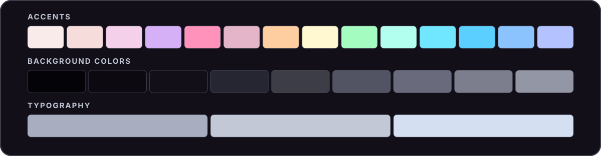

<div align="center">

# ☕ Torrefatto

**tor-reh-FAHT-toh**

An unofficial, near-black [Catppuccin](https://catppuccin.com/)-inspired color palette.



</div>

## Palette

### Accents

| Color | Hex | Color | Hex |
| :-- | :-- | :-- | :-- |
| Rosewater | `#f8ebea` | Yellow | `#fff8d0` |
| Flamingo | `#f7dcdc` | Green | `#a5fcc0` |
| Pink | `#f5d0ea` | Teal | `#b3ffef` |
| Mauve | `#d6b0f7` | Sky | `#70e7ff` |
| Red | `#ff92bb` | Sapphire | `#5bcfff` |
| Maroon | `#e4b4c8` | Blue | `#8bc3ff` |
| Peach | `#ffcea0` | Lavender | `#b4c2ff` |

### Background Colors

| Color | Hex | Color | Hex |
| :-- | :-- | :-- | :-- |
| Crust | `#040408` | Mantle | `#0c0911` |
| Base | `#120f19` | Surface 0 | `#262632` |
| Surface 1 | `#3d3d48` | Surface 2 | `#525464` |
| Overlay 0 | `#696a7c` | Overlay 1 | `#7c7e8e` |
| Overlay 2 | `#9396a4` | | |

### Typography

| Color | Hex |
| :-- | :-- |
| Text | `#d5dff2` |
| Subtext 1 | `#c3c8d6` |
| Subtext 0 | `#a9adc0` |

## Files

| File | Format |
| :-- | :-- |
| [`torrefatto.json`](torrefatto.json) | Named hex colors |
| [`torrefatto.css`](torrefatto.css) | CSS custom properties (`--ctp-torrefatto-*`) |
| [`whiskers-overrides.json`](whiskers-overrides.json) | Optional Whiskers color overrides |

### CSS

Load [`torrefatto.css`](torrefatto.css) and reference the variables:

```css
@import url("./torrefatto.css");

body {
  background: var(--ctp-torrefatto-base);
  color: var(--ctp-torrefatto-text);
}

a {
  color: var(--ctp-torrefatto-blue);
}
```

<details>
<summary>Whiskers</summary>

Render a [Whiskers](https://whiskers.catppuccin.com/concepts/overrides/) template with Torrefatto colors and flavor names:

```sh
sed -E \
  -e 's/\{\{[[:space:]]*flavor\.identifier[[:space:]]*\}\}/torrefatto/g' \
  -e 's/\{\{[[:space:]]*flavor\.name[[:space:]]*\}\}/Torrefatto/g' \
  template.tera | whiskers - -f mocha --color-overrides whiskers-overrides.json
```

</details>

## License

[MIT](LICENSE). Torrefatto is an independent project, not affiliated with or endorsed by Catppuccin.
